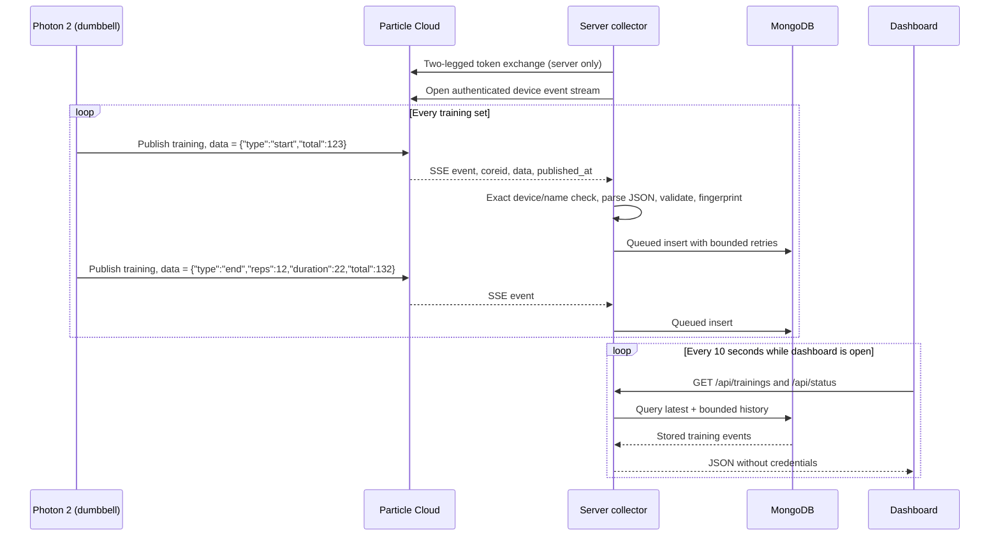

# Data flow

## Event collection

The Particle event-name filter matches prefixes. The application checks the **exact** configured name (`training`) again. It also verifies the configured device ID even though the stream URL is already device-scoped.

## The training contract

The firmware publishes two kinds of events. The event `data` is a JSON string:

| `type`  | Published when                                                            | Fields                                                                                           |
| ------- | ------------------------------------------------------------------------- | ------------------------------------------------------------------------------------------------ |
| `start` | The third regular repetition is recognized (at least 3 s after the first) | `total`: device total including these repetitions                                                |
| `end`   | Five seconds have passed without a repetition                             | `reps` (1–10,000), `duration` in whole seconds from first to last repetition (0–86,400), `total` |

`total` is an integer from 0 to 2,147,483,647 (the firmware’s signed 32-bit `int`). The envelope must include `coreid` and a valid `published_at` timestamp; a publication more than five minutes in the future is rejected. Unknown types, text values, fractions, missing fields and the earlier text format (`end;reps=12;duration=22`) are rejected. Malformed events increment the rejected counter and do not stop collection. Validation lives in `normalizeEvent` in `src/lib/server/training-events.ts`.

`publishedAt` is the cloud publication time. `receivedAt` records when the server processed the event.

## From events to sets

`src/lib/training.ts` derives everything the dashboard shows from stored events. The same code runs on the server and in the browser:

- **A set** is one `end` event. Its last repetition happened about five seconds before publication (the end pause); its first repetition `duration` seconds before that. **Pace** is `duration / (reps − 1)` seconds per repetition, because n repetitions span n − 1 intervals.
- **Today** counts sets since local midnight in the viewer’s timezone. The server does not know that timezone, so the browser computes it.
- **A set in progress** is shown when the newest event is a `start` less than 15 minutes old, or when the device reports `repetitions > 0`. The 15-minute limit prevents a lost `end` event from showing a running set forever.

The history API returns at most 500 events (the newest 250 sets) for ranges of 1–30 days.

## Read the device variables

`Read device now` and automatic reads → `GET /api/device/state` → shared five-second cache → shared request budget (only on a cache miss) → Particle REST API → firmware variables `repetitions`, `totalCount` and `sensorOk` → JSON result → current-set card, total card and sensor badge.

The dashboard reads automatically every five seconds while a set is running and every 30 seconds otherwise. The server cache means that many open tabs still cause at most one device request per five seconds. A read is an on-demand observation; it does not insert history.

## Call a function

`Reset total count` → browser confirmation → same-origin `POST /api/device/reset` → shared request budget → Particle function `resetTotal("0")` → return code `0`.

The firmware sets its total to zero and stores that in its EEPROM. It does not publish an event, and stored sets stay in the history. If a reset times out, read the device before trying again: the command might have reached it.

## Node-RED mapping

| Original node/behavior           | Application equivalent                                        |
| -------------------------------- | ------------------------------------------------------------- |
| `particle-cloud-subscribe`       | `ParticleClient.stream`, collector started by the server hook |
| Payload transformation function  | `normalizeEvent` in `server/training-events.ts`               |
| MongoDB `insertOne`              | `MongoTrainingEvents.insert` through the write queue          |
| `ui_text` Counter Value          | Current-set and total cards                                   |
| `particle-cloud-function`        | Fixed reset endpoint and `ParticleClient.resetTotal`          |
| `particle-cloud-variable`        | State endpoint and `ParticleClient.readState`                 |
| MongoDB `find` / createChartData | Bounded history query, `buildSets` and `SetChart.svelte`      |
| Debug sidebar                    | Collector status, sanitized logs and browser feedback         |

The source flow’s account-wide event subscription has been narrowed to the configured device.
